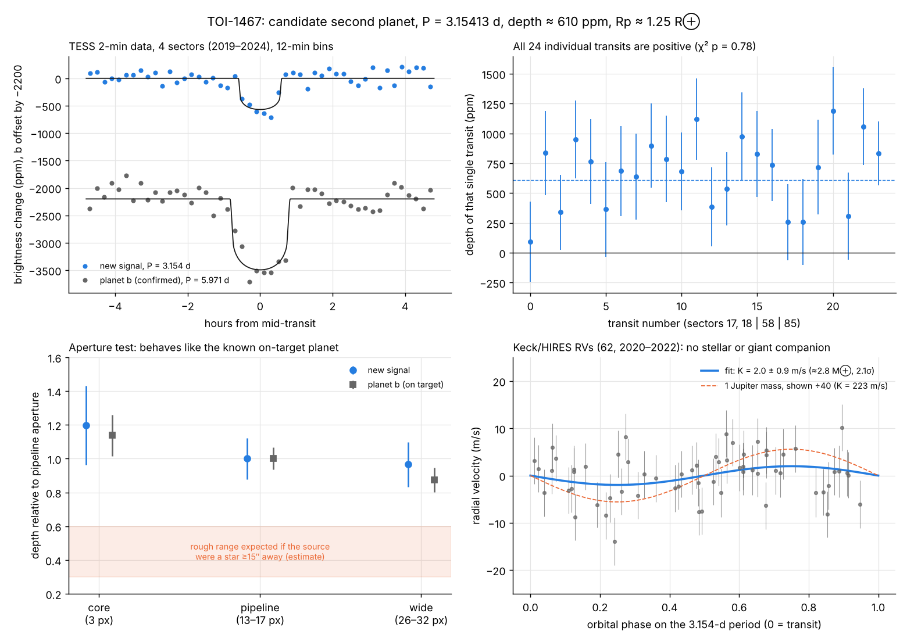
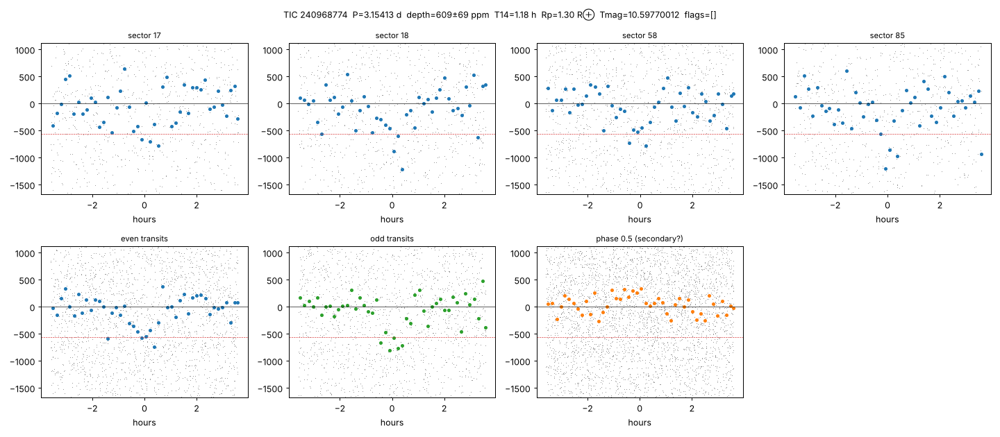

# An independent detection and vetting of a second, inner transit-like signal in the TOI-1467 system

**Austin Claybrook**

Signal found in an independent search on 2026-11-26, first recorded about 23:00 UTC.
Report of 2026-11-27. Not peer reviewed. This is a **planet candidate**, not
a confirmed planet.

## Abstract

TOI-1467 is an M0/M1 dwarf at 37.4 pc hosting a confirmed transiting
super-Earth, TOI-1467 b (P = 5.971 d, Rp ≈ 1.9 R⊕).

**Detection.** In a blind multi-sector box-least-squares search of 1,942
nearby K and M dwarfs in TESS data, we independently detect a second
periodic transit-like signal in this system once b is masked. It has
P = 3.1541320 ± 0.0000041 d, depth 609 ± 69 ppm and duration ≈ 1.2 h,
implying Rp ≈ 1.25–1.30 R⊕. The same period appears as a second
threshold-crossing event in the SPOC sector 14–86 Data Validation report.
It is not a TESS Object of Interest.

**Vetting.**
- The signal is present in all four 2-minute-cadence sectors (2019–2024).
- All 24 individual transits have positive, mutually consistent depths.
- The depth is consistent across odd/even transits and across photometric
  apertures, behaving like the confirmed on-target planet b.
- The signal is absent from inverted light curves.
- Published Keck/HIRES radial velocities limit its mass to M sin i < 5.5 M⊕
  (2σ), excluding stellar and substellar eclipsing companions at this period.
- With the archival Keck adaptive-optics contrast curve, TRICERATOPS gives a
  false-positive probability of 0.002. The probability of a nearby false
  positive is 0.002, slightly above the conventional 0.001 validation limit,
  owing to two faint (T = 16.8) neighbours at 16″ and 32″.

A single ground-based transit observation showing that these neighbours do
not undergo ~20% eclipses would complete a statistical validation of
TOI-1467 candidate 2.

## 1. Data and search

- **Data:** TESS SPOC 2-min PDCSAP light curves of TIC 240968774, sectors 17
  and 18 (2019), 58 (2022) and 85 (2024), from the public MAST archive.
- **Preparation:** flagged cadences, isolated data fragments and the first
  0.25 d after data gaps were removed. Each sector was normalised and
  detrended with a robust sliding biweight filter, 0.75-d window (Hippke et
  al. 2019).
- **Search:** box least squares over 0.5–20 d, on a period grid uniform in
  log-frequency. For multi-year gapped data we used a semi-coherent scheme:
  per-season searches combined, then refined coherently.
- **Detection thresholds:** SDE ≥ 7, S/N ≥ 7.1, ≥ 3 transits.
- **Survey:** the search covered 1,942 nearby (< 60 pc) K/M dwarfs
  (Tmag < 11.5), 5,989 star-sectors and 6.8 × 10⁷ photometric measurements.
  Known TOI transits were masked before searching.
- **What it finds here:** the first signal is TOI-1467 b (we recover
  Rp = 1.92 R⊕). After masking b, the second is the 3.154-d signal
  (SDE 9.3, S/N 9.0). Transit Least Squares (Hippke & Heller 2019)
  independently recovers P = 3.154127 d, depth 643 ppm, duration 1.15 h,
  S/N 9.7, with 24 distinct transits.

## 2. Transit parameters

Fit with a limb-darkened transit model (batman), circular orbit, 30% Gaussian
prior on stellar density from TIC v8 (R* = 0.491 ± 0.015 R☉,
M* = 0.489 M☉, Teff = 3834 K):

| Parameter | Value |
|---|---|
| P | 3.1541320 ± 0.0000041 d |
| T0 | BTJD 2887.1638 ± 0.0011 (BJD_TDB 2459887.1638) |
| Depth | 609 ± 69 ppm |
| T14 | 1.18 h |
| b | ≈ 0.7 (poorly constrained) |
| Rp | 1.25–1.30 ± 0.07 R⊕ (statistical only) |
| a | 0.033 AU |
| Teq | ≈ 710 K |
| Insolation | ≈ 43 S⊕ |

The period ratio with b is 1.893.

## 3. Vetting

1. **Persistence.**
   - Sector depths: 399 ± 135, 665 ± 124, 561 ± 103 and 711 ± 136 ppm
     (χ² p = 0.36).
   - The 2019 and 2022–24 halves detect it independently, at S/N 6.1 and
     7.7.
   - All 24 single-transit depths are positive, χ² = 17.5 for 23 dof.
   - Minimum leave-one-out S/N is 9.2.
2. **Eclipsing-binary tests.**
   - Odd/even depths consistent (1.1σ; SPOC: significance 0.18).
   - No secondary eclipse.
   - A transit-like box is preferred over sinusoidal variability by ΔBIC = 126.
3. **Location.**
   - Aperture test: photometry rebuilt from the 2-min target-pixel files
     with 3-pixel core, pipeline and pipeline+1-pixel masks. Depth ratios are
     1.20 / 1.00 / 0.97, against 1.14 / 1.00 / 0.87 for the confirmed
     on-target planet b. A source ≥ 15″ away would make the core depth fall
     sharply.
   - SPOC's ghost diagnostic: core 5.8, halo 0.79.
   - SPOC difference-image centroids are dominated by systematics. Planet b
     shows the same several-arcsecond per-sector scatter, so they are not
     discriminating.
4. **Radial velocities.** We fit the 62 Keck/HIRES RVs published by the
   TESS-Keck Survey (Polanski et al. 2024) with circular orbits for b and
   this signal, both phased to the transit ephemerides, adding 4.6 m/s
   jitter. This gives K = 1.98 ± 0.94 m/s, i.e. K < 3.9 m/s (2σ) and
   M sin i < 5.5 M⊕. Any stellar (K ~ 20 km/s) or brown-dwarf (K ~ 3 km/s)
   eclipsing companion to TOI-1467 at this period is excluded.
5. **Statistical validation.** We ran TRICERATOPS (Giacalone et al. 2021) on
   SPOC apertures for all four sectors.
   - **Without imaging:** FPP = 0.14.
   - **With the Keck/NIRC2 K-band AO contrast curve** (ExoFOP, 2020-09-09):
     FPP = 0.0021 ± 0.0002 and NFPP = 0.0020.
   - **The residual NFPP** is from TIC 240968773 (16″) and TIC 240968785
     (32″), both T = 16.8, which would need ~18–23% eclipses.
   - **Not included:** the lower false-positive rate of candidates in systems
     with a confirmed transiting planet (Lissauer et al. 2012).
6. **Search-level false-alarm control.** Over the 1,940 survey stars, the
   same search and vetting applied to inverted light curves yields no false
   alarms at 1–10 d periods, against 5 real signals.

Per-sector, odd/even and phase-0.5 diagnostics:

## 4. Follow-up needed

- **One ground-based transit**, to exclude ~20% eclipses on the two T = 16.8
  neighbours. This is feasible with 0.3–0.5 m telescopes.
- Predicted mid-transits (±3 min):
  - 2026-11-28 06:14 UTC
  - 2026-12-01 09:56 UTC
  - 2026-12-04 13:38 UTC
  - 2026-12-07 17:20 UTC
  - 2026-12-10 21:02 UTC
- Detecting the 600 ppm transit itself needs ≳ 1 m telescopes.
- High-precision RVs (K ≈ 1.5–2.5 m/s) would give the mass.

## 5. Data and code

All data are public (MAST, ExoFOP). Supporting tables are in `data/`:
- `candidate_parameters.csv`: fit and catalogue values in ExoFOP's upload fields;
- `per_transit_depths.csv`: depth and S/N of each of the 24 transits;
- `folded_lightcurve_6min.csv`: the folded, binned light curve;
- `validation_results.md`: every test and its result.

The analysis code is available from the author. The software builds on wotan, astropy,
batman, transitleastsquares, lightkurve and triceratops. Code development and
analysis used an AI coding assistant under the author's direction; all
numbers were produced by the released code.

## References

- Giacalone et al. 2021, AJ 161, 24 (TRICERATOPS)
- Hippke et al. 2019, AJ 158, 143 (wotan)
- Hippke & Heller 2019, A&A 623, A39 (TLS)
- Kovács, Zucker & Mazeh 2002, A&A 391, 369 (BLS)
- Lissauer et al. 2012, ApJ 750, 112
- Mistry et al. 2024, PASA 41, 30 (TOI-1467 b)
- Polanski et al. 2024, ApJS (TESS-Keck Survey XX), arXiv:2405.14786
- Twicken et al. 2018, PASP 130, 064502 (SPOC Data Validation)
